  

  
  
  
  
  
  
  
  

---

# 🛒 Awesome Ecommerce Platform Ecosystem

> **The definitive directory of enterprise SaaS solutions and open-source commerce platforms.**  
> Curated for enterprise architects, software engineers, technical founders, and digital commerce leaders evaluating platforms for **storefront management**, **headless & composable commerce**, **omnichannel retail**, and **B2B/B2C scale**.

---

## 🧭 Table of Contents

- [📊 Sector Overview & Market Dynamics](#-sector-overview--market-dynamics)
- [🏢 Enterprise SaaS & Hosted Platforms](#-enterprise-saas--hosted-platforms)
- [🌟 Open-Source GitHub Projects](#-open-source-github-projects)
- [🧩 Architectural Comparison: Headless vs Full-Stack](#-architectural-comparison-headless-vs-full-stack)
- [🤝 How to Contribute](#-how-to-contribute)
- [💖 Support](#-support)
- [📈 Star History](#--star-history)
- [⚖️ Disclaimer](#-disclaimer)

---

## 📊 Sector Overview & Market Dynamics

The global **ecommerce software and platform market** is estimated at **$8.2 billion in 2024 and is projected to expand to over $19.5 billion by 2030**, compounding at an annual growth rate (CAGR) of **~15.2%**.

The sector exhibits **moderate fragmentation with pronounced tier-based concentration**:
- **Mass-Market & DTC Retail:** Highly concentrated around category champions like **Shopify** and **WooCommerce**, which capture the overwhelming majority of small-to-medium storefront deployments.
- **Enterprise & Composable B2B/B2C:** Moderately fragmented and transitioning rapidly away from monolithic legacy architectures. Enterprise spend is divided between established enterprise ERP-integrated giants (**SAP Commerce Cloud**, **Salesforce Commerce Cloud**, **Oracle Commerce**, **Adobe Commerce**) and innovative MACH-aligned composable platforms (**commercetools**, **Medusa**, **Saleor**, **Spryker**).

---

## 🏢 Enterprise SaaS & Hosted Platforms

The table below compiles leading commercial and SaaS ecommerce solutions, sorted by **Company Scale (Valuation / Market Capitalization / Annual Revenue)** in descending order.

| 🌐 Platform / Solution | 📊 Company Scale (Valuation / Revenue) | 💰 Starting Pricing | 🎁 Free Tier / Free Trial Limits | ⚡ Primary Architecture & Key Capabilities |
| :--- | :--- | :--- | :--- | :--- |
| **[Oracle Commerce](https://www.oracle.com/commerce/)** | **~$480B Valuation** (Market Cap)   *(~$53B Annual Revenue)* | **Starts at ~$15,000/month**   *(~$180,000/year base licensing / OCI platform floor)* | **No free forever plan;** 30-day trial via Oracle Cloud Infrastructure ($300 cloud credits, 2 Always Free compute VMs and Autonomous DBs); Commerce software requires guided sales/partner PoC environment. | Deep native integration with Oracle Fusion Cloud ERP, CPQ, and CX suites; enterprise multi-site management, high-volume B2B contract pricing, and complex purchasing workflows. |
| **[Salesforce Commerce Cloud](https://www.salesforce.com/products/commerce-cloud/)** | **~$290B Valuation** (Market Cap)   *(~$34.9B Annual Revenue)* | **Starts at ~$2,500/month**   *(~$30,000/year baseline contract for B2B/Starter; scales at 1%–2% GMV take-rate)* | **No free forever plan;** 30-day proof-of-concept (PoC) sandbox trial via sales/partner request (restricted to 1 non-production sandbox, sample storefront data, no live transaction processing). | Unified B2C & B2B/D2C engine featuring Agentforce AI agents, Einstein AI merchandising, native Order Management (OMS), and composable PWA Kit storefronts. |
| **[SAP Commerce Cloud](https://www.sap.com/products/crm/commerce-cloud.html)** | **~$260B Valuation** (Market Cap)   *(~$34B / €31.2B Annual Revenue)* | **Starts at ~$8,333/month**   *(~$100,000/year base enterprise subscription floor, scaling with transaction GMV bands)* | **No free forever plan;** 30-day guided enterprise PoC demo sandbox via sales/partner request (restricted to preconfigured B2B/B2C demo catalogs and sandbox endpoints, zero live transactions). | Premier enterprise commerce suite natively connected to SAP S/4HANA ERP, featuring advanced multi-tier organizational hierarchies, matrix pricing, and global punchout catalogs. |
| **[Adobe Commerce (Magento)](https://business.adobe.com/products/magento/magento-commerce.html)** | **~$230B Valuation** (Market Cap)   *(~$21.4B Annual Revenue)* | **Starts at $1,833/month**   *(~$22,000/year for On-Premises license; Cloud edition starts at ~$3,333/month / $40,000/year based on GMV)* | **No free forever plan;** 30-day sales-assisted cloud PoC sandbox (capped at 1 staging/sandbox environment, sample Luma catalog dataset, live payment gateways disabled; Magento Open Source remains free self-hosted alternative). | Highly flexible enterprise framework powered by Adobe Sensei AI merchandising, advanced B2B quoting, customer-specific pricing, multi-warehouse inventory, and PaaS/SaaS deployment. |
| **[Shopify Plus](https://www.shopify.com/plus)** | **~$115B Valuation** (Market Cap)   *(~$7.1B Annual Revenue)* | **Starts at $2,300/month**   *(3-year agreement; $2,500/month on 1-year agreement; 0.4% variable platform fee above $800k monthly GMV)* | **No free forever plan;** 14-day free trial on standard Shopify (capped at test checkout and password-protected storefront), plus 30–60 day trial at $399/mo rate for eligible enterprise prospects evaluating Plus features. | High-concurrency enterprise SaaS with unlimited staff accounts, 9 expansion stores included, headless Hydrogen/Oxygen hosting, and customizable checkout extensibility. |
| **[commercetools](https://commercetools.com/)** | **~$1.9B Valuation**   *(Private Unicorn; ~$100M+ Annual Revenue)* | **Starts at ~$3,333/month**   *(~$40,000–$50,000/year base Core Commerce tier, billed based on order volume and API consumption)* | **No free forever plan;** 60-day full-access self-serve free trial with no credit card required (full access to core B2C/B2B APIs, Merchant Center admin console, preconfigured sample datasets; excludes InStore/Frontend add-ons). | Flagship pioneer of MACH architecture (Microservices, API-first, Cloud-native, Headless) with composable components for cart, checkout, catalog, and promotions. |
| **[VTEX](https://vtex.com/)** | **~$1.3B Valuation** (Market Cap)   *(~$202M Annual Revenue)* | **Starts at ~$5,000/month**   *(~$60,000/year base SaaS platform fee plus GMV-tier take rate around 1%–3%)* | **No free forever plan;** 14 to 30-day sales-provisioned sandbox trial (capped at 5 developer workspaces, test payment integrations, and standard API burst limits, no live order settlement). | Collaborative commerce suite combining B2B/B2C storefronts, native multi-vendor marketplace engine (3P sellers), distributed order management (OMS), and conversational AI. |
| **[BigCommerce Enterprise](https://www.bigcommerce.com/enterprise/)** | **~$550M Valuation** (Market Cap)   *(~$318M Annual Revenue)* | **Starts at $1,499/month**   *(~$17,988/year base tier, scaling with GMV thresholds; standard plans start at $29/mo)* | **No free forever plan;** 15-day free trial with no credit card required (can be extended up to 30 days via sales; includes test orders and API access, locks custom SSL and custom live domains, 90-day post-expiration data retention). | Open-SaaS architecture with native multi-storefront (MSF), built-in B2B Edition (custom price lists, quote approvals), unlimited API rate limits, and headless connectors. |
| **[Spryker](https://spryker.com/)** | **~$500M+ Valuation**   *(Venture-Backed; $130M+ Total Funding)* | **Starts at ~$5,000/month**   *(~$60,000–$100,000/year modular enterprise licensing based on transaction volumes and pack modules)* | **No free forever plan;** 30-day guided evaluation sandbox via AWS Marketplace or partner sales demo (limited to staging container instances, sample demoshop data, no external live webhook events). | Composable, API-driven commerce platform engineered specifically for intricate B2B buying processes, enterprise marketplaces, unified commerce, and IoT scenarios. |
| **[Elastic Path](https://www.elasticpath.com/)** | **~$250M+ Valuation**   *(Venture-Backed; $150M+ Total Funding)* | **Starts at $4,125/month**   *(~$49,500/year published base tier for Composable Commerce, scaling with catalog size and API calls)* | **No free forever plan;** 14-day free developer trial via AWS Marketplace or direct sales request (limited to sandbox test catalogs, 500 API calls/day, non-production webhooks, and sample frontends). | Composable, API-first headless commerce specializing in complex B2B catalogs, dynamic bundling, unlimited pricebooks, and sub-30ms API responses. |

---

## 🌟 Open-Source GitHub Projects

Explore the most popular self-hosted, headless, and framework-based open-source ecommerce repositories.  
**Sorted strictly by GitHub Star Count (Descending):**

---

### 1. [Medusa](https://github.com/medusajs/medusa) 
- **Tech Stack:** Node.js, TypeScript, Next.js, PostgreSQL, Redis
- **License:** MIT License
- **Key Features:** Fast-growing open-source alternative to Shopify. Provides modular digital commerce primitives (products, multi-region carts, orders, customer groups, fulfillment, swap/claims) with full customization via plugins, workflows, and Next.js starter storefronts.
- **Best Suited For:** Developers and modern brands seeking a modular, headless JavaScript/TypeScript backend without vendor lock-in.

---

### 2. [Bagisto](https://github.com/bagisto/bagisto) 
- **Tech Stack:** PHP, Laravel, Vue.js, MySQL
- **License:** Open Software License (OSL 3.0)
- **Key Features:** Comprehensive Laravel-based ecommerce framework featuring multi-channel inventory, multi-currency, multi-locale, built-in marketplace extensions, PWA capabilities, and headless REST/GraphQL APIs capable of handling 10M+ SKUs.
- **Best Suited For:** PHP/Laravel engineering teams needing an intuitive, production-ready full-stack or headless store.

---

### 3. [Saleor](https://github.com/saleor/saleor) 
- **Tech Stack:** Python, Django, GraphQL, React, PostgreSQL
- **License:** BSD 3-Clause License
- **Key Features:** High-performance, composable, headless commerce engine driven exclusively by GraphQL. Ships with a React-based administrative dashboard, webhooks, multichannel capabilities, and a global multi-currency checkout system.
- **Best Suited For:** Python and React developers building high-traffic, composable omnichannel storefronts.

---

### 4. [Spree Commerce](https://github.com/spree/spree) 
- **Tech Stack:** Ruby on Rails, Next.js / React, PostgreSQL
- **License:** BSD 3-Clause License
- **Key Features:** Battle-tested open-source platform offering complete DTC, B2B, and multi-vendor marketplace capabilities. Modern versions include REST/GraphQL APIs, TypeScript SDKs, and ready-to-deploy Next.js storefronts with zero platform fees.
- **Best Suited For:** Ruby on Rails development shops and established brands requiring total codebase control and rapid iteration.

---

### 5. [Reaction Commerce](https://github.com/reactioncommerce/reaction) 
- **Tech Stack:** Node.js, GraphQL, MongoDB, Docker, Kubernetes
- **License:** GPL-3.0 License
- **Key Features:** Real-time, event-driven headless commerce API built on a microservices foundation. Enables independent scaling of cart, order, and catalog services for high-throughput enterprises.
- **Best Suited For:** Enterprise cloud teams looking for real-time GraphQL microservices and Node.js infrastructure.

---

### 6. [Magento Open Source](https://github.com/magento/magento2) 
- **Tech Stack:** PHP, Symfony components, MariaDB/MySQL, Elasticsearch/OpenSearch
- **License:** Open Software License (OSL 3.0)
- **Key Features:** The self-hosted, community edition of Adobe Commerce. Boasts the world’s largest third-party plugin and theme ecosystem, granular catalog management, multi-site architecture, and extensive agency support.
- **Best Suited For:** Mid-market merchants and agencies needing an extensive extension ecosystem and complete hosting autonomy.

---

### 7. [Vue Storefront / Alokai](https://github.com/vuestorefront/vue-storefront) 
- **Tech Stack:** TypeScript, Vue.js, Nuxt.js, React, Next.js
- **License:** MIT License
- **Key Features:** Frontend as a Service (FaaS) and open-source PWA framework for composable commerce. Integrates out-of-the-box with backends like commercetools, Magento, BigCommerce, Shopify, and SAP Commerce Cloud.
- **Best Suited For:** Frontend engineers building lightning-fast, mobile-first progressive web apps for any headless backend.

---

### 8. [WooCommerce](https://github.com/woocommerce/woocommerce) 
- **Tech Stack:** PHP, WordPress, MySQL, React
- **License:** GNU General Public License (GPLv3)
- **Key Features:** The most widely adopted open-source shopping cart in the world. Directly turns any WordPress installation into a full-featured ecommerce store with thousands of extensions, payment gateways, and themes.
- **Best Suited For:** Small-to-medium businesses, bloggers, and agencies already invested in the WordPress content ecosystem.

---

### 9. [nopCommerce](https://github.com/nopSolutions/nopCommerce) 
- **Tech Stack:** ASP.NET Core, C#, MS SQL Server / PostgreSQL / MySQL
- **License:** nopCommerce Public License (NPL)
- **Key Features:** Leading open-source Microsoft ASP.NET Core ecommerce platform. Offers out-of-the-box multi-store, multi-vendor marketplace, warehouse management, and enterprise B2B features with clean modular architecture.
- **Best Suited For:** .NET / C# enterprise environments seeking a stable, secure, and self-hosted commerce solution.

---

### 10. [PrestaShop](https://github.com/PrestaShop/PrestaShop) 
- **Tech Stack:** PHP, Symfony, MySQL
- **License:** Open Software License (OSL 3.0)
- **Key Features:** Established European ecommerce platform with a comprehensive back-office management console, internationalization tools, multi-shop capabilities, and an active community add-ons marketplace.
- **Best Suited For:** European SMBs and cross-border retailers requiring native multi-currency and regional tax handling.

---

### 11. [Aimeos Laravel](https://github.com/aimeos/aimeos-laravel) 
- **Tech Stack:** PHP, Laravel, MySQL / PostgreSQL
- **License:** LGPLv3
- **Key Features:** Ultra-fast, high-performance PHP/Laravel ecommerce package capable of processing 100,000+ orders per day and scaling to 1 billion products (#gigacommerce) with sub-20ms rendering times.
- **Best Suited For:** High-volume Laravel projects requiring extreme execution speed and complex catalog structures.

---

### 12. [Sylius](https://github.com/Sylius/Sylius) 
- **Tech Stack:** PHP, Symfony, API Platform, PostgreSQL / MySQL
- **License:** MIT License
- **Key Features:** Modern, developer-friendly ecommerce framework built purely on Symfony and API Platform. Clean architectural separation with 100% test coverage, native promotions engine, and modular headless REST/GraphQL APIs.
- **Best Suited For:** Teams with strict software craftsmanship standards building custom, non-standard B2B or B2C workflows.

---

### 13. [Vendure](https://github.com/vendurehq/vendure) 
- **Tech Stack:** TypeScript, Node.js, NestJS, GraphQL, SQLite / PostgreSQL / MariaDB
- **License:** MIT License
- **Key Features:** Headless commerce framework built with TypeScript and NestJS. Emphasizes exceptional developer experience with end-to-end type safety, GraphQL APIs, and a customizable Angular/React admin interface.
- **Best Suited For:** TypeScript full-stack developers seeking an extensible, elegant headless foundation.

---

### 14. [OpenCart](https://github.com/opencart/opencart) 
- **Tech Stack:** PHP, MySQL
- **License:** GNU General Public License (GPLv3)
- **Key Features:** Lightweight, easy-to-install standalone open-source shopping cart with straightforward admin functionality, multi-currency support, order management, and thousands of affordable plugins.
- **Best Suited For:** Budget-conscious merchants seeking an unopinionated, lightweight self-hosted online store.

---

### 15. [Solidus](https://github.com/solidusio/solidus) 
- **Tech Stack:** Ruby on Rails, PostgreSQL
- **License:** BSD 3-Clause License
- **Key Features:** Community-driven fork of Spree Commerce focused on stability, security, clean code architecture, and high-volume enterprise compliance. Includes full REST APIs and headless support.
- **Best Suited For:** Mid-market and enterprise Rails development teams that prioritize codebase stability and test coverage.

---

### 16. [Shopware 6](https://github.com/shopware/shopware) 
- **Tech Stack:** PHP, Symfony, Vue.js, MySQL
- **License:** MIT License (Core)
- **Key Features:** Modern, API-first European commerce platform. Features a flexible drag-and-drop Shopping Experiences CMS, rule builder for pricing and shipping, and an app-store ecosystem.
- **Best Suited For:** European mid-market merchants who want a blend of modern headless capability with intuitive visual content creation.

---

### 17. [Shuup](https://github.com/shuup/shuup) 
- **Tech Stack:** Python, Django, PostgreSQL
- **License:** Open Source (OSL 3.0)
- **Key Features:** Flexible Python/Django ecommerce platform engineered specifically for complex multi-vendor marketplaces, single and multi-tenant configurations, and custom B2B buying rules.
- **Best Suited For:** Python developers building multi-vendor marketplace platforms or custom B2B supplier networks.

---

### 18. [Drupal Commerce](https://github.com/drupalcommerce/commerce) 
- **Tech Stack:** PHP, Drupal, Symfony, MySQL
- **License:** GPL-2.0 License
- **Key Features:** Deeply integrated commerce framework for Drupal. Bridges the gap between complex enterprise content management (CMS) and transactional commerce workflows.
- **Best Suited For:** Content-driven publications, media brands, and universities selling products alongside rich editorial content.

---

### 19. [OroCommerce](https://github.com/oroinc/orocommerce) 
- **Tech Stack:** PHP, Symfony, PostgreSQL / MySQL
- **License:** ORO Public License
- **Key Features:** Open-source digital commerce platform built from the ground up specifically for B2B merchants, wholesalers, manufacturers, and distributors. Includes integrated B2B CRM and CPQ capabilities.
- **Best Suited For:** Dedicated B2B enterprises requiring corporate customer accounts, multi-tier approval rules, and punchout integration.

---

## 🧩 Architectural Comparison: Headless vs Full-Stack

| Paradigm | Exemplary Platforms | Key Architectural Advantages | Trade-Offs to Consider |
| :--- | :--- | :--- | :--- |
| **Headless / Composable (MACH)** | commercetools, Medusa, Saleor, Elastic Path, Vendure | Complete frontend freedom (Next.js, Nuxt, mobile apps); decoupled scaling; no vendor lock-in; sub-100ms API response times. | Requires higher engineering overhead, custom orchestration, and frontend maintenance. |
| **Enterprise Cloud Suites** | Salesforce Commerce, SAP Commerce Cloud, Oracle Commerce | Pre-integrated ERP/CRM stacks; enterprise SLAs; compliance certifications; turn-key global localization. | High total cost of ownership ($50K–$300K+/yr); multi-year lock-in; slower customization cycles. |
| **All-in-One Open Source** | Magento Open Source, Bagisto, Shopware, WooCommerce | Zero software licensing fees; complete data ownership; thousands of ready-made community extensions. | Merchant is responsible for hosting infrastructure, PCI-DSS compliance, security patches, and scaling. |

---

## 🤝 How to Contribute

We welcome contributions from the digital commerce developer community!

1. **Fork** this repository.
2. **Create** a feature branch: `git checkout -b feature/add-new-platform`.
3. **Add or update** entries in `README.md` following the existing format:
   - For SaaS products: Include platform name, company scale (valuation/revenue), starting tier price, and specific free tier/trial limits.
   - For open-source repos: Include tech stack, license, GitHub star badge (`style=social&color=white`), and targeted use case.
4. **Submit a Pull Request** with a concise description of why the tool qualifies for inclusion.

⭐ **If you find this directory valuable, please star this repository!**

---

## 💖 Support

A huge **thank you** to every developer, technical architect, founder, and contributor who explores and builds within the open and composable commerce ecosystem! 

Maintaining and continuously benchmarking this curated directory is driven by a passion for transparent, accessible developer tooling. If this resource has helped your research, architecture planning, or decision-making, please consider supporting the project:

- ⭐ **Star this repository** to improve visibility and help other commerce developers discover it.
- 🍴 **Fork and contribute** your benchmark findings, new open-source projects, and platform corrections.
- 📢 **Share with your team**, tech leaders, and developer networks on LinkedIn, X/Twitter, or Reddit.
- ☕ **Buy a coffee / Sponsor**: If you'd like to support ongoing research and updates, you can sponsor this project via the [GitHub Sponsors Dashboard](https://github.com/sponsors/ishandutta2007):

  

---

##  Star History

---

## ⚖️ Disclaimer

- This is a community-curated directory intended for research, architectural planning, and educational purposes.
- Pricing, valuations, and free tier specifications reflect public disclosures, vendor documentation, and industry benchmarks as of **October 2026**. Consult official vendor sales channels for binding contractual quotations.
- Self-hosted open-source software deployments require diligent security auditing, payment gateway PCI-DSS compliance, and infrastructure management.

---

  <b>Built for merchants, developers, software architects, and ecommerce leaders worldwide. 🚀</b>

